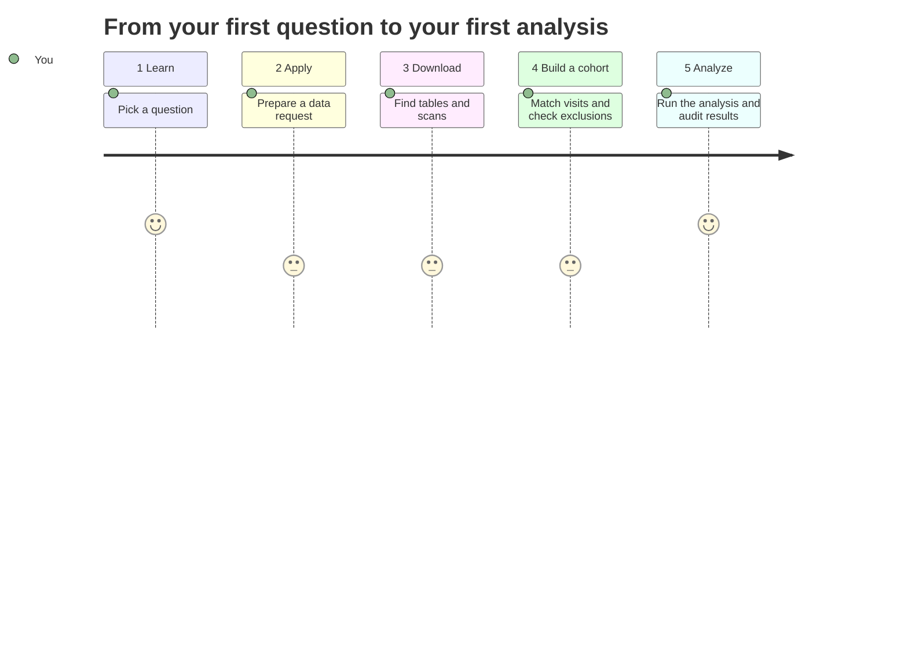

<h1 align="center">🧠 ADNI Research Handbook</h1>

<em>Everything I wish I’d known before my first ADNI download.</em>

  <a href="QUICKSTART.md"><strong>⚡ Try the five-minute exercise</strong></a>
  · <a href="checklists/applicant.md"><strong>🔑 Prepare your application</strong></a>
  · <a href="docs/10-glossary.md"><strong>🔤 Look up a term</strong></a>

A hands-on guide to the Alzheimer’s Disease Neuroimaging Initiative (ADNI) for grad students and postdocs. Start with a fictional example, then learn how to find the right files and build your first cohort.

> [!IMPORTANT]
> This independent handbook uses fictional examples. Apply through [ADNI’s official access page](https://adni.loni.usc.edu/data-samples/adni-data/#AccessData), follow the [Data Use Agreement](https://adni.loni.usc.edu/wp-content/themes/adni_2023/documents/ADNI_Data_Use_Agreement.pdf), and keep participant-level material outside this repository.

## 🗺️ Choose your path

| Where are you today? | Start here | Set aside |
|---|---|---:|
| 🌱 I’m new to ADNI | [See what the study measures](docs/01-what-is-adni.md) | 10 min |
| 🔑 I’m preparing to apply | [Read the applicant checklist](checklists/applicant.md) | 5 min |
| 📂 I have access and need files | [Find your first tables and scans in IDA](docs/13-downloads.md) | 10 min |
| 🧩 My tables aren’t joining cleanly | [Decode IDs, visits, and joins](docs/05-data-structure.md) | 10 min |
| ⚡ I want to try it right now | [Solve a fictional data puzzle](QUICKSTART.md) | 5 min |
| 📝 I’m writing a paper | [Check publication and attribution steps](docs/08-publication-policy.md) | 10 min |

## 📍 Your ADNI journey

<!-- diagram:journey:start -->

<!-- diagram:journey:end -->

Get oriented, prepare your application, find the right exports, build a cohort, then analyze and share your results. You can try the fictional exercise at any stage.

<strong>🔤 Stuck on an acronym? Open the pocket glossary</strong>

| Term | In plain language |
|---|---|
| **IDA** | Image and Data Archive, where approved users retrieve ADNI files. |
| **DUA** | Data Use Agreement, which sets the terms for using and sharing data. |
| **RID** | An identifier for a participant. |
| **Index visit** | The visit your analysis uses as its reference point. |
| **QC** | Quality control, such as checking whether a scan can be used. |

[Open the full glossary](docs/10-glossary.md).

> [!TIP]
> Before writing code, try the [five-minute puzzle](QUICKSTART.md). Can you spot the follow-up row that would slip into a baseline analysis?

## 📚 Explore the chapters

| Chapter | What you’ll learn |
|---|---|
| [🧠 What is ADNI?](docs/01-what-is-adni.md) | Pick a question the study can help answer. |
| [🎭 Who does what](docs/02-the-cast.md) | Find out who collects, processes, and manages the data. |
| [🔑 Getting access](docs/03-getting-access.md) | Draft your plan and find the official application. |
| [🗂️ Data modalities](docs/04-data-modalities.md) | Browse MRI, PET, clinical measures, fluid biomarkers, genetics, and more. |
| [⏳ ADNI1 through ADNI4](docs/06-phases.md) | Learn what to check before combining phases. |
| [📦 Find your first files](docs/13-downloads.md) | Navigate IDA and document your exports. |
| [🧩 IDs, visits, and joins](docs/05-data-structure.md) | Work out what one row represents and catch duplicate joins. |
| [🧰 Build your first cohort](docs/14-build-a-cohort.md) | Choose an index visit, align scan dates, and count exclusions. |
| [⚠️ Common mistakes](docs/07-pitfalls.md) | Troubleshoot missing measurements, scanner differences, and leakage. |
| [🧪 Run your first notebook](docs/09-first-analysis.md) | Join fictional tables and audit who has a usable assessment. |
| [📝 Publish with ADNI data](docs/08-publication-policy.md) | Check attribution, committee review, and what you can share. |
| [🔤 Glossary](docs/10-glossary.md) · [🔗 Resources and FAQ](docs/11-resources-faq.md) | Decode a term or find the right official reference. |

## 🤝 Help improve the handbook

Found a confusing step or an outdated source? [See how to contribute](CONTRIBUTING.md) or check the [maintenance plan](docs/12-contributing.md). Use fictional examples when reporting an issue.

[Source review dates](VERIFICATION.md) · [Changelog](CHANGELOG.md) · [Cite the handbook](CITATION.cff) · [Code license](LICENSE) · [Documentation license](LICENSE-DOCS.md)
