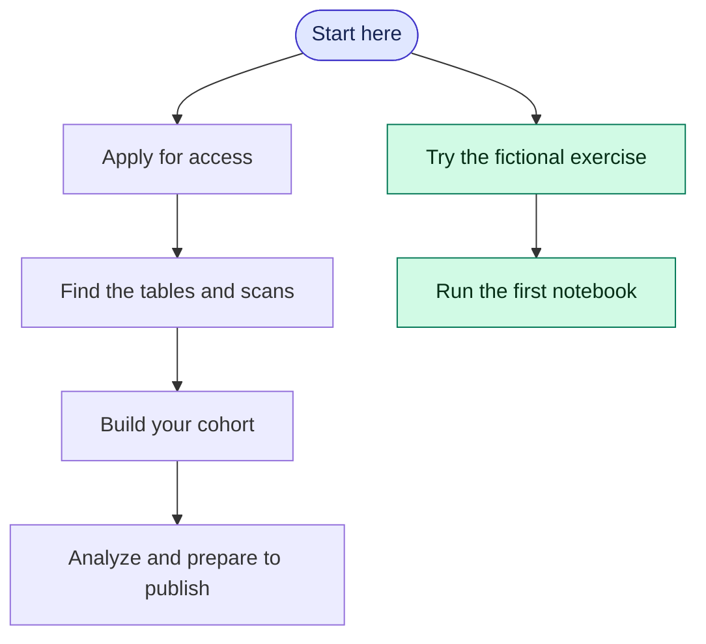

# ADNI Starter Guide

**From your first access request to your first reproducible analysis.**

A practical field guide for grad students and postdocs opening the Alzheimer’s Disease Neuroimaging Initiative (ADNI) archive for the first time.

[**Try the 5-minute exercise**](QUICKSTART.md) · [**Prepare your application**](checklists/applicant.md)

*Independent guide · All examples are fictional · [Source review dates](VERIFICATION.md)*

## Choose your path

| If you’re here… | Start here |
|---|---|
| 🧭 I’m new to ADNI | [What ADNI measures and what you can ask](docs/01-what-is-adni.md) |
| 🔑 I need access | [Application walkthrough](docs/03-getting-access.md) |
| 📦 I have access | [Find and document your first download](docs/13-downloads.md) |
| 🧪 I want to analyze | [Run the synthetic notebook](docs/09-first-analysis.md) |

## Your roadmap

<!-- diagram:journey:start -->

<!-- diagram:journey:end -->

You can run the rehearsal at any stage. For an authorized project follow **Apply → Download → Build a cohort → Analyze**.

## Explore the guide

| Stage | Chapters |
|---|---|
| **Understand** | [Study overview](docs/01-what-is-adni.md) · [Who does what](docs/02-the-cast.md) · [Modalities](docs/04-data-modalities.md) · [Phase differences](docs/06-phases.md) |
| **Get access** | [Apply](docs/03-getting-access.md) · [Applicant checklist](checklists/applicant.md) · [Find files in IDA](docs/13-downloads.md) |
| **Build a cohort** | [IDs, visits and joins](docs/05-data-structure.md) · [Write your cohort rules](docs/14-build-a-cohort.md) · [Troubleshoot](docs/07-pitfalls.md) |
| **Analyze and publish** | [First notebook](docs/09-first-analysis.md) · [Publication policy](docs/08-publication-policy.md) · [Submission checklist](checklists/pre-submission.md) |
| **Keep nearby** | [Glossary](docs/10-glossary.md) · [Official resources and FAQ](docs/11-resources-faq.md) |

> [!IMPORTANT]
> Keep all ADNI participant-level material outside this repository, including derived rows, scans, identifiers, screenshots, and notebook outputs. Obtain access directly from [ADNI](https://adni.loni.usc.edu/data-samples/adni-data/#AccessData) and follow the [Data Use Agreement](https://adni.loni.usc.edu/wp-content/themes/adni_2023/documents/ADNI_Data_Use_Agreement.pdf).

[Contribute or report an error](CONTRIBUTING.md) · [Changelog](CHANGELOG.md) · [Code license](LICENSE) · [Documentation license](LICENSE-DOCS.md)
