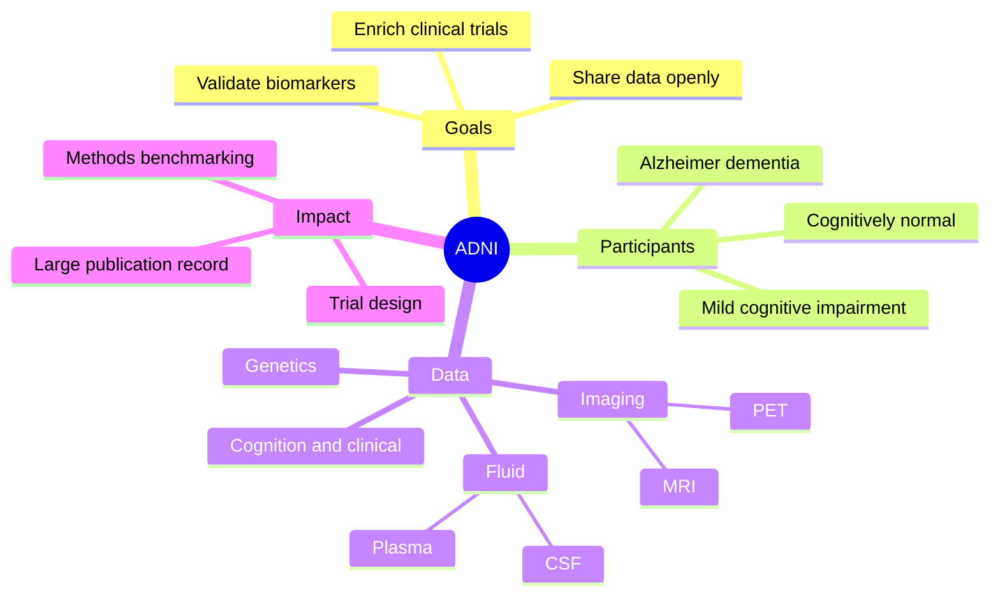

# 🧠 01 · What Is ADNI?

> ⏱️ 10 min · 🟢 Beginner · 📍 Stage 1 of 5: **Learn**

<b>⚡ TL;DR (30 seconds)</b>

- ADNI is a long-running, multi-site **observational** study that follows older adults, from cognitively normal to Alzheimer's dementia, with standardized clinical, cognitive, imaging, fluid-biomarker and genetic measurements.
- Its data are shared with approved researchers worldwide, which is why it is one of the most-used datasets in Alzheimer's research.
- It is **not** a clinical trial and **not** a population sample. Know its limits before you generalize.

## The big picture

<!-- diagram:concept-map:start -->

<!-- diagram:concept-map:end -->

**Text version:** ADNI has four pillars: its *goals* (validate biomarkers, help design clinical trials, share data openly), its *participants* (cognitively normal, mild cognitive impairment, Alzheimer dementia), its *data* (imaging, fluid biomarkers, genetics, cognition and clinical measures) and its *impact* (a very large publication record and influence on trial design).

## What ADNI is

<!-- verified: 2026-11-18 | source: https://adni.loni.usc.edu/about/governance/ | item: adni-overview -->
- **A longitudinal cohort.** Participants return for repeated visits over years, so you can study *change*.
- **Multimodal.** The same people have MRI, PET, fluid biomarkers, cognitive tests and genetics.
- **Standardized.** Imaging protocols and assays are harmonized across sites, which is the whole point.
- **Openly shared** with qualified researchers after an application and Data Use Agreement (see [chapter 03](03-getting-access.md)).
- **Funded** by the US National Institute on Aging (NIA/NIH) with additional support from private-sector partners.

## Why newcomers love it (and why reviewers know it)

| Strength | What it means for you |
|----------|----------------------|
| Rich longitudinal data | Model disease progression, not just snapshots |
| Harmonized protocols | Less scanner/assay chaos than pooling random studies |
| Many modalities per person | Test multimodal ideas (MRI + PET + CSF + cognition) |
| Widely used | Easy benchmarking against published results |
| Open access process | You can start without a collaboration |

## What ADNI is **not**

> [!WARNING]
> ADNI participants are **volunteers recruited to research centers**, and are generally more educated and less
> diverse than the general population. Findings may not generalize to community or clinic populations.
> Newer phases aim to broaden recruitment, but check current cohort composition before you make population-level claims.

- ❌ **Not a clinical trial.** No treatment is assigned. Do not make causal treatment claims.
- ❌ **Not a population-representative sample.** See the warning above.
- ❌ **Not one single dataset.** It is a set of phases with different protocols ([chapter 06](06-phases.md)).
- ❌ **Not a source of ground truth about neuropathology** for most participants. Diagnoses are clinical; autopsy data exist only for a subset.

## Good first questions vs. poor first questions

| ✅ A good fit for ADNI | ⚠️ Think twice |
|------------------------|----------------|
| How does hippocampal atrophy rate differ by amyloid status? | What is the prevalence of AD in the US? (not population-based) |
| Can plasma + MRI predict MCI→dementia conversion? | Does drug X slow decline? (not a trial) |
| Benchmark a new segmentation method on a standard cohort | Findings for populations underrepresented in ADNI |

🕰️ <b>A 60-second history</b>

ADNI began in 2004 and has run in phases (ADNI1, ADNI-GO, ADNI2, ADNI3, ADNI4), each adding participants and measurements, such as amyloid PET, tau PET and, more recently, blood-based biomarkers. See [chapter 06](06-phases.md) for the details and what changed when.

---
[← README](../README.md) · [🏠 Home](../README.md) · [Next → 02 · The cast](02-the-cast.md)
