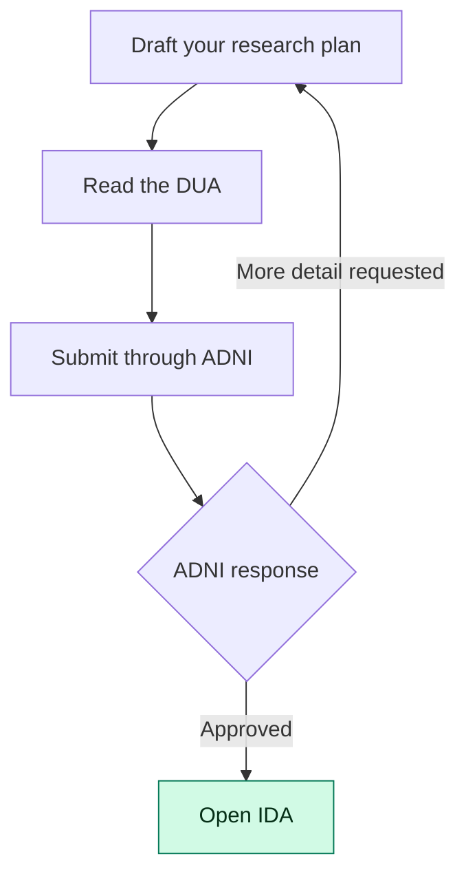

# 🔑 Getting access

**By the end:** you’ll have a short research plan and know where to submit it.

<!-- diagram:access-path:start -->

<!-- diagram:access-path:end -->

Prepare your application, submit it through ADNI, then use the approved account to open the Image and Data Archive (IDA).

## 1. Prepare

<!-- verified: 2026-11-18 | source: https://support.adni4.org/hc/en-us/articles/31090030057236-I-am-a-researcher-how-do-I-access-ADNI-research-data-or-samples | item: access-route -->

Read the [Data Use Agreement (DUA)](https://adni.loni.usc.edu/wp-content/themes/adni_2023/documents/ADNI_Data_Use_Agreement.pdf). Draft your research question, data needs, and analysis plan. Check the current form for investigator and team details. Ask your institution what ethics and storage steps apply to your project.

> [!TIP]
> Start with two sentences. “We will estimate the availability of baseline structural MRI among eligible participants in the specified ADNI phases. We will combine diagnosis and scan metadata, count unique participants, and report aggregate coverage by phase.”

## 2. Apply

Use the [official data access page](https://adni.loni.usc.edu/data-samples/adni-data/#AccessData). For physical specimens such as blood or DNA samples, use the separate [biospecimen route](https://adni.loni.usc.edu/data-samples/adni-samples/#ApplyForAccessToSamples). Follow the instructions in the form and any response from ADNI.

## 3. After approval

Sign into [LONI IDA](https://ida.loni.usc.edu/) and follow the [first-download walkthrough](13-downloads.md). Keep authorized files outside your Git checkout in institution-approved storage. Confirm the terms for team use, identify team members as required, and respond to annual use updates.

[Applicant checklist](../checklists/applicant.md) · [Home](../README.md) · [Next → Data modalities](04-data-modalities.md)
