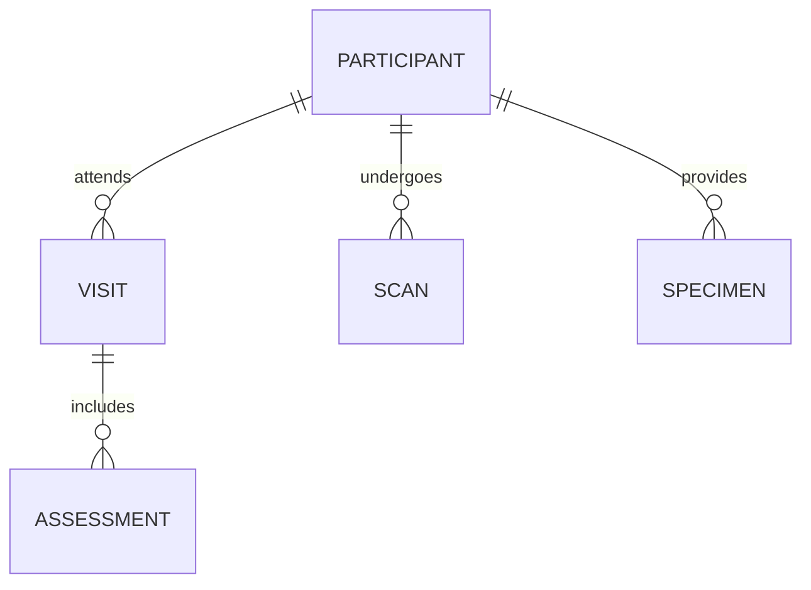
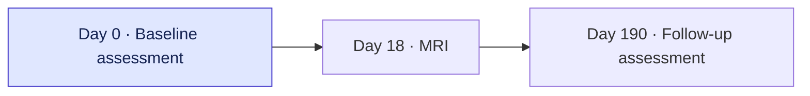

# 🧩 IDs, visits and joins

**By the end:** you’ll know what a row represents and how to catch a join that produces extra rows.

<!-- diagram:table-relationships:start -->

<!-- diagram:table-relationships:end -->

This conceptual map shows that one person can have many visits, scans, and specimens. A visit can have multiple assessment records. Check the grain of each actual export.

## Read the keys

<!-- verified: 2026-11-18 | source: https://adni.loni.usc.edu/quick-start-guide-asset/datadic.html | item: dictionary-use -->

| Concept | Fields you may see | What to verify |
|---|---|---|
| Participant | `RID`, `PTID` | Use a documented mapping if exports use different identifiers. |
| Visit | `VISCODE`, `VISCODE2` | Check phase applicability and definitions. An identically named column can have different coverage. |
| Date | `EXAMDATE`, modality-specific dates | Identify the actual exam, acquisition, or collection date. Keep administrative timestamps separate. |
| Phase | `PHASE`, `COLPROT`, `ORIGPROT` | Distinguish original enrollment from the phase of collection. |
| Image | Export-specific image ID | Check whether the record identifies an acquisition or a processed image. |

Read the [official data dictionary guide](https://adni.loni.usc.edu/quick-start-guide-asset/datadic.html) and the methods document for each file. Record the exact table version. For convenience exports such as ADNIMERGE, check which phases, visits, and variables the specific version includes.

<!-- diagram:visit-schedule:start -->

<!-- diagram:visit-schedule:end -->

**Fictional timeline:** a participant has an assessment at baseline, an MRI later, and another assessment at follow-up. Use the protocol and actual dates to determine which measurements fit your study question.

## Test a join on paper

Two scans and two cognitive assessments for one person produce **four rows** if you join on person alone. Start by deciding whether you want one row per participant, visit, or scan. Choose the key and any date-matching rules with that goal in mind.

For prepared tables that should have one record per person and visit, the following example checks that expectation. These are fictional column names.

```python
keys = ["person", "visit"]
for table in (index_visits, assessments):
    if table[keys].isna().any().any():
        raise ValueError("Resolve missing join keys first")

joined = index_visits.merge(
    assessments, on=keys, how="left", validate="one_to_one", indicator=True
)
assert len(joined) == len(index_visits)
print(joined["_merge"].value_counts())
```

> [!TIP]
> If the join fails, inspect which keys repeat. Repeats can represent real repeat measurements. Apply an explicit selection rule before joining, or choose a different row grain.

[Home](../README.md) · [Next → Build a cohort](14-build-a-cohort.md)
