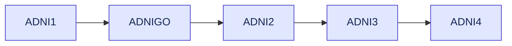

# ⏳ ADNI1 through ADNI4

**By the end:** you’ll know what to check before combining phases.

<!-- verified: 2026-11-18 | source: https://adni.loni.usc.edu/quick-start-guide-asset/pps.html | item: phases-and-rollovers -->
<!-- diagram:phase-timeline:start -->

<!-- diagram:phase-timeline:end -->

ADNI’s protocols evolved from ADNI1 through ADNIGO, ADNI2, ADNI3, and ADNI4. Some people continued into later phases. A phase marks a study protocol and funding cycle. Check the protocol for the phase and participant group behind each measurement.

| Phase | Where to start your comparison | Consequence for analysis |
|---|---|---|
| ADNI1 | Original enrollment and visit schedules | Identify screening and baseline records before selecting the index visit. |
| ADNIGO | GO added early mild cognitive impairment (EMCI) screening. See the [GO procedures manual](https://adni.loni.usc.edu/wp-content/uploads/2024/02/ADNI_GO_Procedures_Manual.pdf). | Check whether a record belongs to new enrollment or continued follow-up. |
| ADNI2 | ADNI2 used cohort-specific definitions and schedules. Compare the [ADNI2 procedures manual](https://adni.loni.usc.edu/wp-content/uploads/2024/02/ADNI2_Procedures_Manual.pdf) with the GO manual. | Check whether group definitions and instruments match earlier phases. |
| ADNI3 | Longitudinal tau PET became a focus. Check ADNI3 imaging and processing documentation. | Record the imaging protocol and processing version for derived measures. |
| ADNI4 | ADNI Online adds a remote digital data stream. Check it alongside the in-clinic protocol. | Check whether a data stream is from the remote digital cohort or in-clinic assessments, and verify coverage for the question. |

For context on the phases, see the [official ADNI history](https://adni.loni.usc.edu/about/governance/). The [official protocols guide](https://adni.loni.usc.edu/quick-start-guide-asset/pps.html) points to **Study Info → Study Protocols & CRFs** in IDA. The [file tour](https://adni.loni.usc.edu/quick-start-guide-asset/filetour.html) describes the ADNI Online files.

## Before pooling

- Check participant identity across phases and record original enrollment separately from collection phase.
- Compare exam schedules, instrument definitions, assay platforms and imaging acquisition/processing. Check units and measurement compatibility before combining values.
- Make a coverage table by phase for the variables you need. Compare the included population across phases.
- For longitudinal outcomes, use the documented diagnosis at the relevant visit and report how you handled missing follow-up and changing diagnoses.

**Methods template:** “We used [export versions] retrieved on [date], covering [phases]. We defined the index visit as [rule], linked repeated records by [key], and handled protocol differences by [rule].”

[Home](../README.md) · [Next → Build a cohort](14-build-a-cohort.md)
