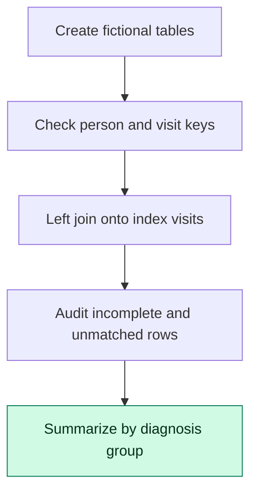

# 🧪 Run your first analysis

**Question:** How many fictional participants in each group have a completed cognitive assessment at their index visit?

<!-- diagram:analysis-pipeline:start -->

<!-- diagram:analysis-pipeline:end -->

You’ll check the keys, keep all index participants in a left join, and count completed, incomplete, and unmatched assessments.

## Run locally

1. Open the project folder in a terminal and install the notebook dependencies with `python -m pip install -r requirements.txt` in a virtual environment.
2. Launch Jupyter with `python -m jupyterlab`. Open [01_first_analysis.ipynb](../notebooks/01_first_analysis.ipynb) and choose **Run → Run All Cells**.
3. Check the printed audit. Across six fictional people you should see **three complete**, **one incomplete**, and **two without a matching assessment**.

The notebook creates all input rows in memory, so it works without ADNI access or external data. Each diagnosis group in the lesson is illustrative.

## After the rehearsal

Use [the cohort checklist](14-build-a-cohort.md) to adapt the logic to a research question. Start by writing the row grain, index rule, and expected match cardinality. Work with authorized files in your approved environment.

[Five-minute exercise](../QUICKSTART.md) · [Home](../README.md) · [Next → Publishing](08-publication-policy.md)
