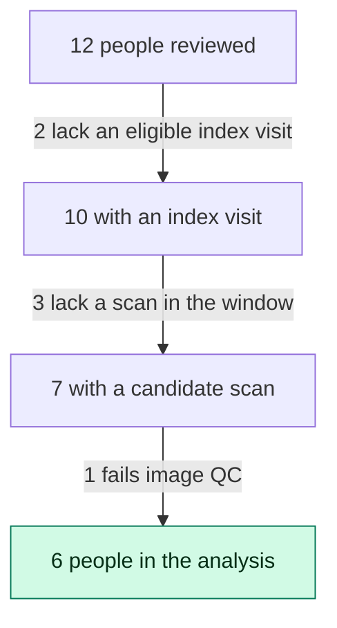

**By the end:** you’ll have a reusable recipe for deciding who enters your analysis and why.

**Example question:** Among fictional participants with a recorded index diagnosis, how many have a usable MRI near that visit?

Fictional audit: start with 12 people. Ten have an eligible index record, seven have a scan in the example window, and six have a scan that passes QC.

| Decision | Example to adapt |
|---|---|
| Unit and target | One row per person for a cross-sectional question. A follow-up outcome calls for an explicit time horizon and censoring rules. |
| Eligibility | Specify phases, diagnosis definition, and what counts as an index visit. Track people who roll into another phase. |
| Time alignment | Try a prespecified window such as ±60 days for this fictional descriptive analysis. For a prospective prediction task, limit feature availability to the intended prediction time. |
| Multiple matches | Apply QC first, choose the closest eligible scan, and break a tie with a documented rule such as the earlier acquisition. Record the date offset. |
| Missing data | Log the reason for each exclusion. Compare included and excluded participants across relevant groups and phases. |
| Reproducibility | Record export versions, filters, selection rules, and counts after each step. Keep individual audit rows in the approved environment. |

[Home](/) · [Next → Common mistakes](/pitfalls)
