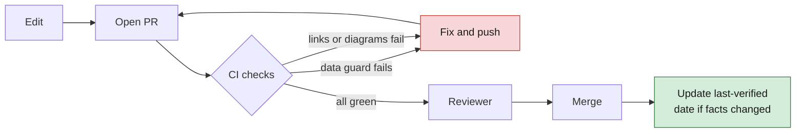

> ⏱️ 10 min · For contributors and maintainers

> **Caution:**
> **Rule zero: never commit ADNI data**, including CSV excerpts, screenshots, notebook outputs, real subject IDs (`XXX_S_NNNN`) or lists of RIDs/image IDs. CI blocks common cases, but it is a safety net, not a guarantee.

## The pull-request lifecycle





**Text version:** edit → open a PR → CI checks (data guard, links, diagrams, notebook tests) → fix and push if anything fails → reviewer → merge → update the last-verified date if facts changed.

## How we keep this guide from going stale

| Mechanism | What it does | Where |
|-----------|--------------|-------|
| **Verified tags** | Each volatile fact carries `` | All chapters |
| **Freshness check** | Fails or warns when a tag is older than ~3 months or `never` | `scripts/check_verified.py`, `freshness.yml` |
| **Register** | Review dates and sources | [VERIFICATION.md](https://github.com/hussainahmad8587/adni-research-handbook/blob/main/adni-starter-guide/VERIFICATION.md) |
| **Link check** | Weekly and on PRs; opens an issue if links rot | `links.yml` (lychee) |
| **Diagram render check** | Renders every Mermaid file with mermaid-cli | `checks.yml` |
| **Notebook CI** | Executes the synthetic notebook and checks its expected results | `checks.yml` |
| **Data guard** | Rejects data-like files, notebook outputs and ID patterns | `scripts/check_no_data.py` |
| **Versioning** | Calendar versions `vYYYY.N` + [CHANGELOG](https://github.com/hussainahmad8587/adni-research-handbook/blob/main/adni-starter-guide/CHANGELOG.md) + phase coverage in chapter 06 | Releases |

### Review cadence
- **Quarterly:** work through VERIFICATION.md, rerun the synthetic notebook, and tag a release.
- **On each ADNI announcement** (data release, new phase, policy change): open a *Phase update* issue within two weeks.

## Editing diagrams

Diagrams live in `diagrams/*.mmd` (single source of truth). Chapters embed copies between markers:

```text
<!-- diagram:<name>:start -->
<!-- diagram:<name>:end -->
```

After editing a `.mmd` file run `python scripts/sync_diagrams.py`. CI runs it with `--check`.
Keep each diagram under ~15 nodes; avoid custom themes and click handlers; always add a **text version** below it for accessibility.

## Local setup

```bash
pip install -r requirements-dev.txt
pre-commit install
python scripts/check_no_data.py && python scripts/check_mermaid.py && python scripts/sync_diagrams.py --check
jupyter nbconvert --to notebook --execute notebooks/01_first_analysis.ipynb --output-dir /tmp --output adni-lesson.ipynb
```

## 🚨 Incident response: "I committed ADNI data"

1. Stop pushing and notify maintainers privately. If the material was published, restrict access promptly.
2. Contact the institutional data steward and follow the current DUA and incident-response process. Keep incident details out of public issues.
3. Coordinate cleanup of Git history, forks, cached views and generated artifacts with maintainers and GitHub Support. Review how the material reached the repository and update the safeguards.

## Phase update checklist (for new ADNI releases)

- [ ] Tables or columns changed? Update chapters 04–05 and the cohort guidance
- [ ] New tracers/assays? Update chapters 04, 06, 07
- [ ] Access steps changed? Update chapter 03 and the applicant checklist
- [ ] Publication policy changed? Update chapter 08 and the pre-submission checklist
- [ ] Update the phase coverage in chapter 06, VERIFICATION.md and the CHANGELOG; tag a release

---
[← 11 · Resources & FAQ](/resources-faq) · [🏠 Home](/)
