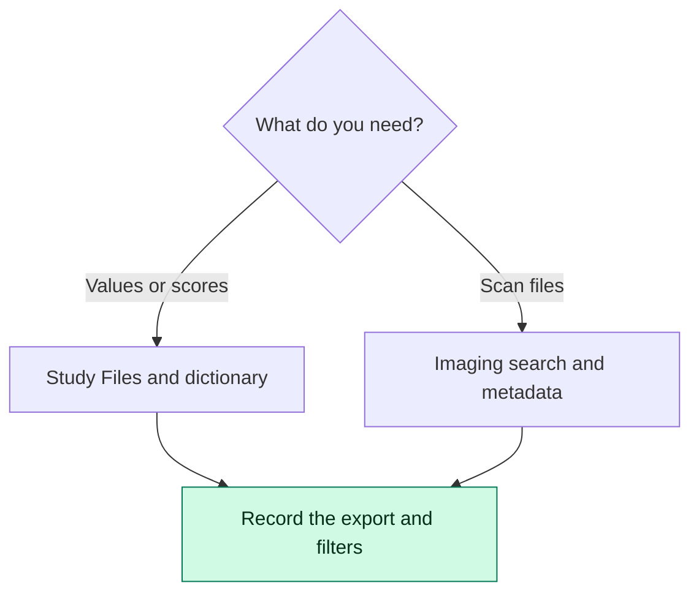

**By the end:** you’ll know where to look for tables and scans and what to record when you download them.

Start with the study table and dictionary for tabular questions. For scan files, use the archive’s imaging search or collections and retain acquisition and processing metadata.

## Start small

1. Open [IDA](https://ida.loni.usc.edu/) with approved access. For the current menu names follow the [official documentation](https://adni.loni.usc.edu/help-faqs/adni-documentation/).
2. In Study Files, find **Study Info → Data & Database** for the dictionary and **Study Protocols & CRFs** for schedules and forms. Pick one assessment or demographic export for your first question.
3. For an imaging project, decide whether you need scans or derived measurements such as regional volumes. For scan downloads, record the search or collection, modality, acquisition date field, and processing/QC selection. Check file format and storage needs before downloading in bulk.
4. Keep the files and private inventory in your approved storage. Record retrieval date and export name, release/version if available, filters, methods document, and a checksum for each downloaded file.

> **Tip:**
> An analysis using regional volumes can often start from a documented derived table. Check its processing pipeline, QC and phase coverage before treating it as your imaging input.

[Home](/) · [Next → Processing MRI and PET images](/image-processing)
