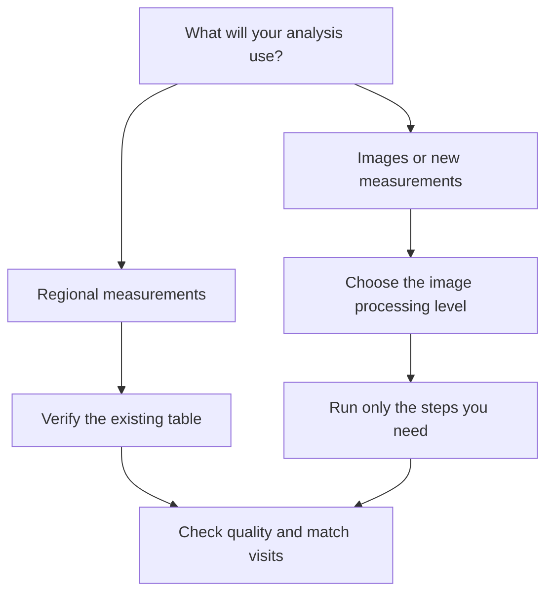

Start with the output your research question needs. If you only need hippocampal volume or an amyloid PET summary, look for a suitable ADNI-derived table before downloading scans. If your analysis uses image voxels or requires a new measurement, choose an image product and document every processing step.

## Choose your starting point

| Goal | Start with | Check before using it |
|---|---|---|
| Compare hippocampal volumes | An ADNI-derived MRI table | Pipeline version, units, quality flags, and whether to account for intracranial volume |
| Build a voxel-based T1 model | A documented T1 image series | Acquisition date, existing corrections, orientation, and target space |
| Compare amyloid burden | A tracer-specific PET summary | Tracer, reference region, pipeline, and units such as SUVR or Centiloids |
| Compute a new PET measure | A PET image series appropriate to the analysis | Tracer, frame handling, existing processing, and whether a corresponding T1 scan is needed |

## T1 MRI workflow

1. **Identify the series.** Record the series identifier, acquisition date, ADNI phase, and processing description. Choose one series per intended visit using a rule set in advance.
2. **Check what ADNI already applied.** Scanner and phase determine which corrections are in the image you downloaded. Consult [ADNI’s MRI preprocessing documentation](https://adni.loni.usc.edu/data-samples/adni-data/neuroimaging/mri/mri-pre-processing/) before adding or repeating a correction.
3. **Inspect the scan.** Review three planes for orientation, coverage, motion or other artifacts. If you convert DICOM to NIfTI, record the converter and verify orientation and voxel size afterward.
4. **Process for your output.** For regional volumes or thickness, use a documented segmentation pipeline such as FreeSurfer and inspect the regional boundaries. For a voxel-based analysis, define whether you need alignment to a common template, resampling, masking, or intensity normalization. Inspect the result of any registration.

## PET workflow

1. **Identify the tracer and product.** FDG, amyloid, and tau PET answer different questions. Check whether the selected product contains individual frames, an averaged image, or additional preprocessing. Use the matching [ADNI PET Core documentation](https://adni.loni.usc.edu/data-samples/adni-data/neuroimaging/pet/).
2. **Match to MRI when your method needs it.** If you use MRI-derived regions, select a suitable T1 exam, record the acquisition-date offset, and inspect the PET-to-MRI overlay. Check whether alignment has already been performed in the product you selected.
3. **Define the measurement.** For a standardized uptake value ratio (SUVR), specify the target region and the tracer- and pipeline-appropriate reference region. Record choices such as partial-volume correction and any published conversion to Centiloids. Compare values across protocols only when their scales and definitions are compatible.
4. **Inspect the result.** Review coverage, alignment and the reference-region mask. Log exclusions with their reasons.

## Worked example with fictional data

Suppose your study asks whether baseline cognition is associated with hippocampal volume. You find a documented table with left and right hippocampal volumes. Select the eligible scan nearest each participant’s index visit within a prespecified window, check the segmentation quality flags, and record the date offset. You can do this without reprocessing the T1 images.

If your question changes to predicting diagnosis from whole-brain voxels, start with a suitable T1 series and split by participant before fitting any cohort-level preprocessing or model. Keep repeat scans from the same participant in the same split.

## Keep a processing record

Log acquisition date, modality or tracer, product and processing version, tool versions and settings, output space, quality decisions, and the reason for each exclusion. Keep this inventory and all participant-level scans in approved storage. Use fictional examples in public documentation.

[Find your first files in IDA](/downloads) · [Build your first cohort](/build-a-cohort)
