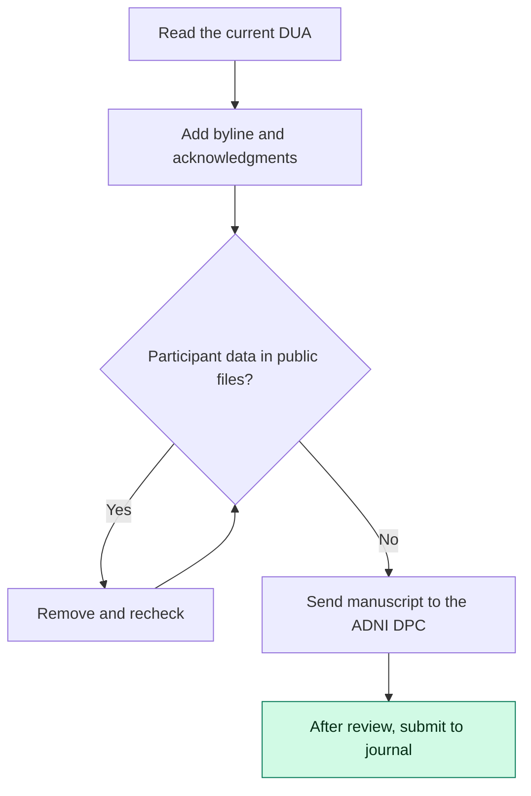

**By the end:** you’ll know which wording to look up and when to send a manuscript to ADNI.

**Manuscript sequence:** review the DUA, prepare the byline and acknowledgments, audit the files, send the manuscript to ADNI for administrative review, then submit to the journal.

| Output | What to check |
|---|---|
| **Manuscript** | Use the ADNI group byline and linked contributor statement, methods wording, and funding acknowledgment in the DUA. Check the additional wording if your dataset calls for it. Submit to the ADNI Data and Publications Committee (DPC) before journal submission using the current IDA/email instructions. |
| **Abstract** | Credit ADNI and its funding sources as space allows. The DUA treats the ADNI author line differently for abstracts. |
| **Preprint, thesis, or other format** | Confirm how the instructions apply before posting or depositing. |
| **Public code and supplements** | Share code and synthetic fixtures with cleared outputs. Participant-level raw or derived data, scans, and ID lists stay out of public files. Use the official derived-data submission route if your work should be considered for controlled distribution. |

The DPC checks attribution and related requirements administratively. Read the [current DUA and Appendix A](https://adni.loni.usc.edu/wp-content/themes/adni_2023/documents/ADNI_Data_Use_Agreement.pdf) and [publication policy](https://adni.loni.usc.edu/wp-content/uploads/how_to_apply/ADNI_DSP_Policy.pdf) for the exact process. Appendix A addresses AI and handling of inputs and outputs. Keep ADNI participant information out of public AI tools, cloud notebooks, GitHub issues, and CI.

> **Tip:**
> Give readers a route to reproduce your cohort: specify the archive, export versions, dates, eligibility rules, and modeling code. Keep the participant-level manifest in authorized storage.

[Pre-submission checklist](https://github.com/hussainahmad8587/adni-research-handbook/blob/main/adni-starter-guide/checklists/pre-submission.md) · [Home](/)
