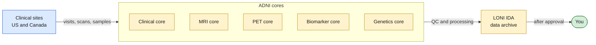

> ⏱️ 8 min · 🟢 Beginner · 📍 Stage 1 of 5: **Learn**

### ⚡ TL;DR (30 seconds)

ADNI is a team sport. Sites collect data; specialist **cores** process it; the informatics core (LONI) serves it to you.
Knowing *who made a file* tells you how to interpret it. The prefix in a file name (like `UCSF…` or `UPENN…`) is often the group that processed it.

**Text version:** clinical sites send visits, scans and samples to the ADNI cores (clinical, MRI, PET, biomarker, genetics). The cores perform QC and processing, the results are stored in the LONI Image & Data Archive, and you reach them after your access is approved.

## The cores (roles)

| Core / group | What it does | What it means for your data |
|--------------|--------------|-----------------------------|
| **Clinical core** | Participant recruitment, diagnosis, clinical and cognitive assessments | Diagnosis columns, cognitive scores, medical history |
| **MRI core** | MRI protocols, QC, and processing standards | Image QC flags; harmonized acquisition |
| **PET core** | PET acquisition and processing standards, summary measures | SUVR tables for amyloid, tau, FDG |
| **Biomarker core** | CSF and blood assays | Assay platform matters (see [pitfalls](/pitfalls)) |
| **Genetics core** | Genotyping and sequencing | APOE status; genome-wide data |
| **Informatics core (LONI)** | Archive and download portal (IDA) | Where you log in; data dictionary |
| **Biostatistics core** | Study design and analysis support | Methods guidance |
| **Data & Publications Committee** | Reviews access applications and oversees publication policy | The people behind approvals ([chapter 08](/publication-policy)) |

## Decoding file-name prefixes

Many ADNI tables start with a short prefix that hints at the producer. Examples you will commonly meet (⚠ verify against the data dictionary):

| Prefix (example) | Typically contains |
|------------------|--------------------|
| `UCSFFSX…` / `UCSFFSL…` | FreeSurfer-derived MRI measures (cross-sectional / longitudinal pipelines) |
| `UCBERKELEY…` | PET summary measures (amyloid, tau, FDG) |
| `UPENNBIOMK…` | CSF biomarker measurements |
| `APOERES` | APOE genotype |
| `DXSUM…` | Diagnostic summary |
| `ADNIMERGE` | A merged convenience table (not a primary source) |

> **Tip:**
> When you cite a derived measure, name the **processing group and pipeline version**, not just "ADNI". Reviewers and replicators will ask.

---
[← 01 · What is ADNI?](/what-is-adni) · [🏠 Home](/) · [Next → 03 · Getting access](/03-getting-access)
